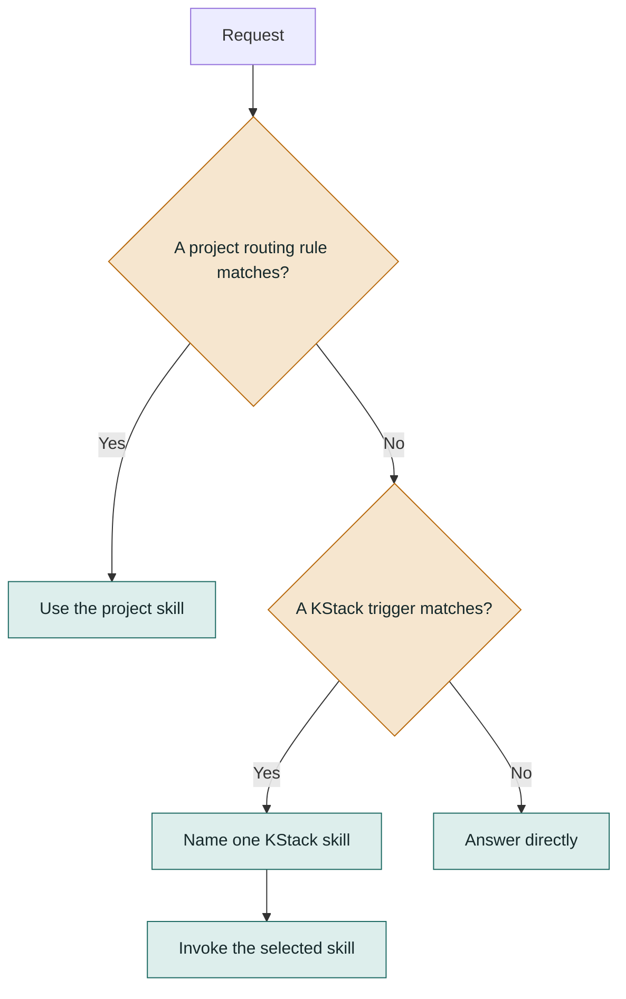
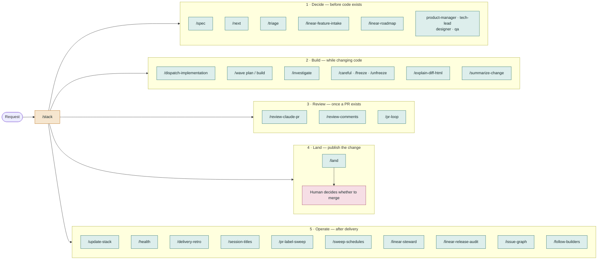
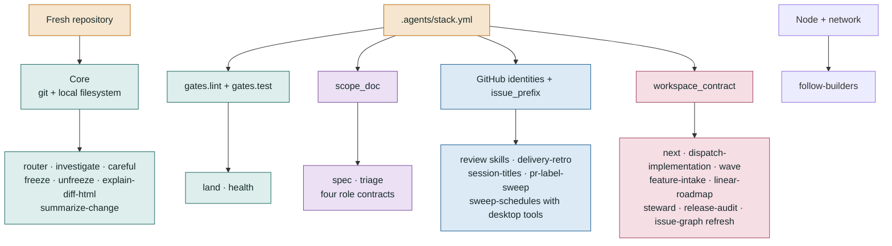
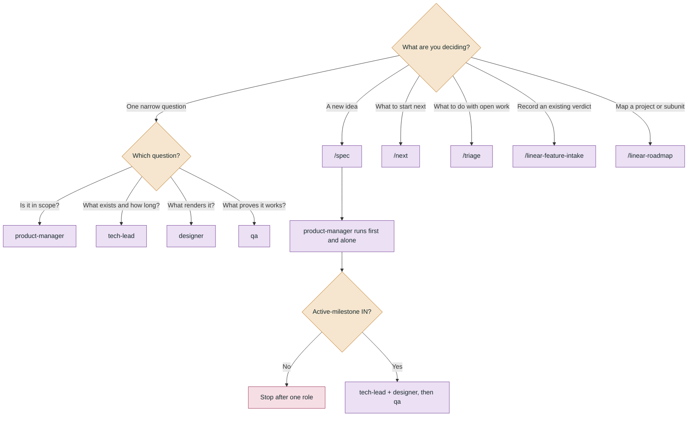
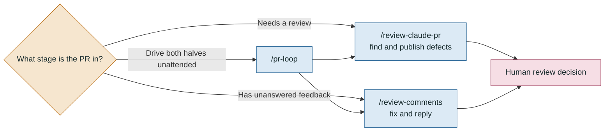

# KStack visual guide

KStack has two independent dimensions:

1. **Workflow phase** — when a skill is useful: decide, build, review, land, or
   operate.
2. **Capability tier** — what the skill needs: local files, a scope contract,
   GitHub, Linear, or the vendored digest's Node runtime and network access.

The [`/stack` router](../router/stack/SKILL.md) matches a request to one skill.
It names the route and stops; the selected skill does the work.

> Mermaid diagrams below render directly on GitHub. For filtering by trigger
> phrase or dependency, open the [interactive skill map](skill-map.html) in a
> browser after cloning the repository.

## How the router works

Project skills take precedence because they know the consuming repository's
domain. This is kstack's routing policy: explicitly select the project contract
when names collide. Codex can display both versions in its skill selector.

## The workflow map

The phases describe **when** to use a skill. They do not imply an automatic
pipeline: KStack deliberately does not chain a decision, implementation,
review, and merge into one unattended action.

## The capability tiers

A skill lives in the least capable tier that can still deliver its core value.
The tiers are not quality levels; they describe dependencies.

| Tier | Core dependency | Skills |
|---|---|---|
| Router | Local files | [`/stack`](../router/stack/SKILL.md) |
| Core | Git + local filesystem | [`/investigate`](../core/investigate/SKILL.md), [`/careful`](../core/careful/SKILL.md), [`/freeze`](../core/freeze/SKILL.md), [`/unfreeze`](../core/unfreeze/SKILL.md), [`/explain-diff-html`](../core/explain-diff-html/SKILL.md), [`/summarize-change`](../core/summarize-change/SKILL.md), [`/land`](../core/land/SKILL.md), [`/health`](../core/health/SKILL.md), [`/update-stack`](../core/update-stack/SKILL.md) |
| Roles | `scope_doc` | [`/spec`](../roles/spec/SKILL.md), [`/triage`](../roles/triage/SKILL.md), [`product-manager`](../roles/product-manager.md), [`tech-lead`](../roles/tech-lead.md), [`designer`](../roles/designer.md), [`qa`](../roles/qa.md) |
| GitHub | `gh`; review identities and CI policy where required; desktop tools for scheduling | [`/review-claude-pr`](../tools/github/review-claude-pr/SKILL.md), [`/review-comments`](../tools/github/review-comments/SKILL.md), [`/pr-loop`](../tools/github/pr-loop/SKILL.md), [`/delivery-retro`](../tools/github/delivery-retro/SKILL.md), [`/session-titles`](../tools/github/session-titles/SKILL.md), [`/pr-label-sweep`](../tools/github/pr-label-sweep/SKILL.md), [`/sweep-schedules`](../tools/github/sweep-schedules/SKILL.md) |
| Linear | Tracker rules and scope; local viewer operations need no tracker | [`/next`](../tools/linear/next/SKILL.md), [`/dispatch-implementation`](../tools/linear/dispatch-implementation/SKILL.md), [`/wave`](../tools/linear/wave/SKILL.md), [`/linear-feature-intake`](../tools/linear/linear-feature-intake/SKILL.md), [`/linear-roadmap`](../tools/linear/linear-roadmap/SKILL.md), [`/linear-steward`](../tools/linear/linear-steward/SKILL.md), [`/linear-release-audit`](../tools/linear/linear-release-audit/SKILL.md), [`/issue-graph`](../tools/linear/issue-graph/SKILL.md) |
| External | Node, network, and the vendored skill's dependencies | [`/follow-builders`](../tools/external/follow-builders/SKILL.md) |

[`/issue-graph`](../tools/linear/issue-graph/SKILL.md) opens an existing local viewer
without tracker access; refreshing it also needs fresh Linear reads. It projects
the existing indexed roadmap without changing its scope or dependencies.

These tiers locate skills; they do not list every prerequisite. The
[onboarding table](../project-template/ONBOARDING.md#which-keys-unlock-which-skills)
maps configuration to capabilities. Required gates refuse when absent;
review-model and wave limits use documented, announced defaults. Read-only
triage retains UNKNOWN assessments for missing interpretation inputs.

## The decision cluster

`/linear-roadmap` consumes existing tickets or drafts proposed work; it validates
a local typed record and generates its Mermaid view without launching sessions.
`--publish` explicitly opens or updates a graph PR; `--local-graph` on supported
execution skills explicitly selects a validated local source while retaining
scope, dependency, evidence, and human-decision requirements.
See the root [orchestration contract](../ORCHESTRATION.md).

`/next` and `/triage` are complements: `/next` looks forward at what to start;
`/triage` looks backward at work already left open.

The single-role path answers one question. Establish the scope verdict before
asking `tech-lead` to estimate; `product-manager` can answer the scope question
alone. A new idea requiring the full pipeline starts with `/spec`.

`/next` recommends one issue by default, or a bounded independent batch with
`--parallel` and repeated `--project` filters. `/triage` defaults to PRs and
supports a project union intersected with labels; it includes intent,
current-head CI/review evidence, unresolved threads, and merge lanes.
Both preserve scope boundaries and create no execution permission.

Project-wide graph coverage warnings do not automatically block an independently
verified mapped candidate. Candidate eligibility and bounded maintenance
reconciliation follow the [publication contract](../tools/linear/linear-roadmap/references/publication-gate.md).

## The review cluster

The implementation session keeps fixes; the opposite engine reviews under a
separate verified account. `/pr-loop` resolves the route from authorship
evidence and is bounded by a round cap and repeat-finding detection. Claude
implementation with Codex review is the default, but the route can reverse.

`CLEAN` requires the configured CI checks at the reviewed head as well as the
review result. `ci.checks: none` is an explicit, reported exception for a
repository without CI. A later push invalidates the earlier head's evidence.
The optional `/pr-loop --merge` path requires human authorization and its merge
gates; `/land` always stops at the PR.

## Briefings and recurring work

Use `/summarize-change` for a briefing in the chat: intent and its source,
approach, relevant constraints, departures from intent, sensitive ranges,
blast radius, and the decision needed. `--tight` retains the investigation but
caps the emitted briefing at 250 words. `/explain-diff-html` creates a durable
teaching page; `/delivery-retro` compares periods of work.

Manual session-title and PR-label sweeps default to dry-run. `/sweep-schedules`
creates or updates a desktop schedule only when requested; installing a skill
does not activate it. `/follow-builders` is a vendored digest workflow with its
own setup and explicitly chosen delivery channels.

`/linear-release-audit` is read-only by default. Its explicit `--apply` mode
can correct tracker statuses and publish a status update after its safeguards.

## The constraints that shape KStack

- `/land` stops at the pull request; merging is a human decision.
- The scope gate defaults to **OUT** when there is no cited evidence.
- A merged pull request is not evidence that a release gate passed.
- Commits, changed lines, and pull-request counts are never outcome scores.
- Acceptance criteria must name a runnable check or be explicitly classified
  as human judgment.
- Enforcement is labeled honestly as hook-enforced, tool-list-enforced, or
  prompt-level.

For exact routing phrases and tie-break rules, read the canonical
[`/stack` contract](../router/stack/SKILL.md).

Read [host support](../hosts/HOSTS.md) before interpreting enforcement labels:
the investigation rule is prompt-level; optional freeze hooks are separate.
Kstack's Codex pointers do not register its guards, even though current Codex
supports separately configured hooks.

`/wave` selects work, records shared agreements, and requires human-approved
plans. Legacy execution checks seams before review; opt-in streaming can overlap
builds and reviews and checks agreements against the final reviewed heads. Local
graph waves keep agreements in the approved handoff rather than a separate
contract PR. Claude Code runs the graph; Codex selects only. Humans approve plans
and merge PRs.
