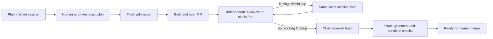

# Make one wave competitive with three persistent ticket sessions

Status: proposed implementation scope, 2026-10-21. This PR changes documentation,
not runtime behavior. The owner's request authorizes this investigation and scope;
it is not a milestone verdict or permission to implement every item below.

**Decision proposed:** keep `/wave plan` and `/wave build` as the user interface,
but make the execution unit a ticket with a persistent session. Start eligible
review work as each ticket becomes ready, use a rolling queue, and hold final
handoffs only for dependencies that actually affect that ticket. Deliver the
scheduling improvements independently of the larger session adapter.

The benchmark is `/next --parallel 3` followed by three independent
`/dispatch-implementation` sessions, continued through equivalent review and CI.
The goal is comparable delivery time with less human coordination, while retaining
scope, approval, identity, worktree, review and CI evidence.

## Evidence and limits of this investigation

Repository observations refer to main commit
`962729e665e1be02489d06a34945b0b278d8a741`, with the subsequent bidirectional
review helpers checked at `046926fbb6ada2f454c4ec58fce01ee5f9b65f82`. They describe
code and instructions, not measured production latency. No paid implementation
sessions were launched for this design and no run timing distribution was collected.

| Observation | Source | Consequence |
| --- | --- | --- |
| Selection, shared-literal scan, and optional contract publication precede all ticket plans | [`wave.js`, A1–A4](../tools/linear/wave/workflow/wave.js) | Serial work sits on the plan critical path |
| Every B1 completes before B2 or any B3 starts | Same file, `const built=await pipeline(...)` | A short ticket waits for the longest implementation |
| B3 uses fixed slices of `review_concurrency`, awaiting each whole slice | Same file, B3 loop | Even concurrency 2 leaves an idle slot when one review finishes early |
| A separate admission agent precedes each project-linked review | Same file, `readmit` | Needed freshness today, but another context and host startup |
| Every agent receives `JSON.stringify(args)` in `common` | Same file, `common` | Whole-wave plans and evidence enter nodes that need one ticket |
| A4 and B1 are separate calls; ordinary dispatch resumes its executor | [`dispatch §4`](../tools/linear/dispatch-implementation/SKILL.md) | The worktree persists; the planner's conversation does not |
| B3 wraps the entire synchronous review/fix/CI loop | [`pr-loop`](../tools/github/pr-loop/SKILL.md) | A reviewer slot is held during fixes, tests and CI waiting |
| B2 checks branch tips before review fixes; it does not run again afterward | [`wave.js`](../tools/linear/wave/workflow/wave.js), [`seam-check`](../tools/linear/wave/bin/seam-check) | Scheduling changes must address final-head evidence, not merely move the existing barrier |

For three project-linked tickets the documented current graph uses 14 agent
calls without contract work, or 16 with A3 and B2, before the nested Codex reviews.
These counts do not measure speed. Provider queueing, cache hits, tool startup,
reasoning time and review findings can dominate differently across runs.

The user's Ogur configuration inspected on 2026-10-21 allows five review rounds,
defaults review concurrency to one, uses `make lint` and `make test-changed`,
and requires all configured CI checks. Those are pilot observations, not new
global kstack defaults. Full local test suites are excluded from the comparison:
Ogur's full-suite authority is GitHub CI, and the shared machine has 16 GB RAM.

[PR #43](https://github.com/khalilouardini/kstack/pull/43) separately removes
contract-publication work for new local-graph waves. Its approved literal snapshot
and seam validation remain requirements for this design. This design does not
depend on that PR being merged in order to be reviewed.

## Define what “competitive” measures

Record four endpoints for each arm: all plans ready, each implementation PR open,
first ticket ready for human merge, and all selected tickets ready for human merge.
Opening a PR is not equivalent to passing review and CI. Report time to each
ticket's readiness as well as the batch makespan; the aggregate must not hide a
short ticket waiting behind a long one.

Compare the same accepted scope, base snapshot, model and effort settings,
reviewer model/routing, round cap, test policy, integrations and approval policy.
Record actual resolved models rather than aliases. Use three arms:

1. Current wave, to isolate regressions and gains from its replacement.
2. Manual persistent sessions under the same resource limits and batch approval
   boundary, to isolate orchestration overhead.
3. The user's normal manual workflow, including early per-ticket approvals and
   actual review concurrency. This is the practical target; report its differing
   policy instead of normalizing away its advantage.

Separate active work, dependency/queue waits, human decision latency, CI waits,
and provider limits. Show wall-clock totals too: subtracting CI or human waits is
useful diagnosis, not proof the user receives results sooner. Capture token and
cost data where available, maximum resident memory and swap change, failures,
human interventions, duplicate side effects and unfinished work. A faster failed
or incomplete arm is not a speed win.

Proposed promotion criteria, not achieved measurements: on the pilot suite,
median all-ticket completion within 10% of the comparable manual arm, first-ticket
readiness within 10%, and no orchestration-caused duplicate writes, lost approvals
or stale CLEAN evidence. Total tokens should not exceed the manual arm by more
than 15% without an explained tradeoff. Report all repetitions and ranges; do not
claim p95 confidence from a few waves. Run at least three counterbalanced paired
repetitions per scenario, recording warm/cold cache and concurrent machine load.
Use resettable fixture tasks for repeatability, then one bounded authorized live
wave for external validity. Human coordination time is a separate benefit.

## Why scheduling comes before increasing concurrency

For builds completing at times `b[i]` and reviews lasting `r[i]`, the present
single-reviewer path costs approximately `max(b) + sum(r)` after build starts.
Independent ticket paths with enough review slots approach `max(b[i] + r[i])`.
With fewer reviewers, completion follows a queue with release time `b[i]`.
Freshness and final agreement checks add work to each path; these expressions
are deliberately simplified scheduling bounds, not runtime forecasts.

Example: build completion at 4, 9 and 20 minutes, review durations 6, 2 and 3.
No findings, CI delay or shared agreement is included. Arithmetic was checked
with a small min-heap scheduler during this investigation.

| Schedule | Ticket completion times | Entire batch |
| --- | --- | --- |
| Current barrier, one reviewer | 26, 28, 31 | 31 minutes |
| Barrier, fixed batches of two | 26, 22, 29 | 29 minutes |
| Barrier, rolling queue of two | 26, 22, 25 | 26 minutes |
| Review on readiness, one reviewer | 10, 12, 23 | 23 minutes |
| Review on readiness, two reviewers | 10, 11, 23 | 23 minutes |
| Three independent reviewers | 10, 11, 23 | 23 minutes |

This does not promise a 26% real-world speedup. It demonstrates avoidable idle
time even at concurrency one. Increasing concurrency alone leaves the build
barrier and fixed-batch inefficiency in place and can increase rate limiting or
swap. Start with three ticket sessions and one paid reviewer; evaluate two paid
reviewers only after telemetry supports it. These are separate budgets, with an
additional limit on simultaneous expensive local test/build commands. Release a
reviewer permit while waiting for an implementation fix or CI.

## Scope and order of delivery

Each row is an independently reviewable implementation slice, not an instruction
to open all the PRs now. The order limits host uncertainty and keeps a working
fallback throughout.

| Slice | Deliverable | Acceptance boundary |
| --- | --- | --- |
| 0. Baseline and host probe | Local event records, comparative fixtures, session capability report | No model downgrade or execution-policy change; time and cost remain distinguishable |
| 1. Lean scheduling | Narrow node inputs, rolling B3 queue, immediate review for tickets with no cross-ticket obligations | Tests prove early review and slot reuse; admission still runs before writes |
| 2. Shared agreements and review continuation | Final-head agreement evidence, scoped invalidation, resumable review phases | Review may overlap builds, but readiness requires current evidence; round caps and identity rules survive resumes |
| 3. Persistent ticket sessions | One session through plan, build and fixes; bounded local controller | Host probe proves session identity, permissions, worktree and model continuity; failures preserve recoverable state |
| 4. Controlled pilot | Paired benchmark, compare normal manual workflow, decide defaults | Promote only with measured parity and correctness; otherwise keep legacy execution or use the manual path |

In scope: one fixed wave, up to the existing supported parallel count; the first
pilot uses three. Existing commands and selected membership remain stable.
Implementation is opt-in until the pilot passes. The existing Workflow path stays
available, but switching engines midway requires explicit reconciliation, never
automatic replay.

Out of scope: selecting further waves, autonomous plan approval, automatic merges,
deployments, scope changes, a new product UI, universal model changes, replacing
Linear admission with cached status, and blanket reduction of the review cap.
The broader [project controller experiment](../ORCHESTRATION.md) remains separate.
This design is its bounded throughput precursor, not a claim that its full
lifecycle or Desktop integration already works.

## Ticket execution and cross-ticket evidence

Use this conceptual state progression; these are proposed controller states,
not new values accepted by today's RUN_A or WAVE_REPORT schemas:

A ticket without a shared agreement or sibling-dependent question can progress
as soon as its own build is ready. Initially retain the existing B3 admission
node and validation. Waiting for unrelated builds is not a freshness check.

For shared agreements, distinguish two things. Literal assertions in the current
checker are fixed constraints against each branch's changed files; they can be
checked per branch as soon as that head exists. Semantic integration questions
may require several participants. Keep the `SHARED_LITERAL.tracks` membership
and an explicit participant set for each question; a missing or unknown set
conservatively requires all selected tracks. Common vocabulary alone must not
silently create a dependency or authorize a new interface.

Independent PR review can proceed while a related participant is still building.
Do not publish a final wave-ready status until required participants have final
reviewed heads and the relevant checks pass. Gate only the connected participants;
a ticket outside that group can be handed to the human immediately. If a
participant is STOPPED or unapproved, the group remains blocked unless its
obligation is already satisfied by verified main evidence or the human approves
a revised plan/contract. Absence is not a passing seam row.

Add final-head evidence containing the literal/contract digest, base SHA, every
participant's exact commit SHA, row results and checked question sources. Re-run
the inexpensive deterministic literal checks after review fixes and before
readiness. Resolve each Git ref once and operate on those immutable commits;
re-read refs before publishing the result. A changed head invalidates its checks
and dependent conclusions. Never use an earlier B2 pass as evidence about a new
head. Missing rows, errors, stale questions and failed assertions stay visible.

The existing checker only proves string presence in changed files. `UNCHANGED`
does not prove product behavior, and a literal match does not prove semantic
integration. Product regression tests and explicit acceptance evidence still
belong to the ticket. No new whole-repository test run is required by this design.

Merging a ready ticket is still a human decision. A later merge/base move triggers
fresh relevant admission for pending tickets, preserving the current ancestor,
mergeability and candidate-closure checks. Revalidate at the eventual merge
boundary: readiness is an observation at specified heads, not a permanent permit.

## Reuse evidence without inventing freshness

Replace the all-arguments common prompt with a small stable header and a
stage-specific envelope: ticket identity, verified worktree, approved plan,
required configuration, relevant graph closure and agreement references.
Keep large source observations in a local content-addressed store with schema,
digest and provenance. Nodes receive the minimum necessary facts and paths to
full evidence; audit retention is not reduced. Changing an evidence format or
execution engine invalidates unsupported records explicitly.

Cache immutable Git blobs, canonical procedure versions and parsed schemas by
content hash. Deduplicate concurrent reads of the same provider snapshot and
validate pagination/completeness once for that snapshot. A provider response with
no reliable revision remains an observation, not immutable truth. At a write or
review transition, refresh mutable issue conditions, blockers, head/base refs
and local graph pins, then rerun admission against those observations. A TTL or
matching whole-graph hash alone never authorizes a transition. Failures and partial
responses are UNKNOWN, not reusable passing results.

Keep the existing local-index pin rule in the first implementation. Relaxing it
to per-candidate local edits is a separate semantics change. Refresh relevant
closure evidence when main moves; unrelated graph changes must not freeze
verified siblings, as current admission already specifies.

Do not merely delete the B3 admission agent or ask a reviewer to self-certify
before posting. The script currently checks its observation before allowing the
review node. Replace it only when a deterministic collector plus the existing
admission helper produces equivalent complete reports and the controller checks
them before invoking a writer. Natural-language ambiguity still goes to a
reasoning step. Scope this collector separately if provider access is incomplete.

The current Workflow sandbox cannot run a shell or read files directly. A
deterministic checker still needs a host runner or an agent that executes it.
Slice 1 keeps that execution boundary. Slice 3's host controller can execute
validated helpers directly; it must not invent a filesystem API inside wave.js.

## Persistent sessions: preserve the work, verify the host

Store one mapping per ticket: canonical repository/worktree, branch, full session
ID, actual model/effort, permission state, plan digest, approval event, PR and head.
The implementation session owns planning, coding, tests and fixes. Codex remains
the independent reviewer for the target Claude implementation flow. Preserve
the configured inverse route for Codex-authored work; account names alone do not
select an engine. A session is conversation continuity, not a permanent
process: it can exit at approval and later resume without a fresh planner.

Claude Code 2.1.306 was present locally; its `--help` advertises `--session-id`,
`--resume`, `--permission-mode`, `--model`, `--effort`, `--bg` and `--desktop`.
That proves flag availability, not successful integration. The supported SDK
documents resuming by a captured session ID; do not use “most recent” in a
multi-session controller. [Session documentation](https://code.claude.com/docs/en/agent-sdk/sessions)

Prefer a small CLI/session adapter over introducing an SDK dependency unless the
probe shows a concrete need. Background resume may create a copy when in-place
continuation is unavailable; check the returned full ID and refuse an unexpected
fork. Do not send another resume to a running session.
[Background-session behavior](https://code.claude.com/docs/en/agent-view#dispatch-an-agent-from-your-shell)

Desktop handoff supports an existing CLI session, but refuses one still running
in a terminal or background process. Desktop's session list is distinct from
terminal sessions. A CLI process is therefore not automatically a persistent,
visible Desktop ticket tab. Prove the desired UI handoff and control path; if
unsupported, expose an honest CLI attachment or keep manual Desktop dispatch.
[Desktop handoff](https://code.claude.com/docs/en/desktop#coming-from-the-cli)

Probe one disposable fixture session before choosing the adapter: create in the
existing isolated worktree in actual Plan mode; record its ID and resolved
settings; stop at a plan; resume the exact ID after an explicit fixture approval;
verify retained context and permitted write scope; interrupt/recover; then prove
that a second controller cannot resume it concurrently. Exercise one approved
write in the fixture, not a production ticket. Check installed skills and MCP
access in the chosen host, since Desktop and standalone CLI may differ.

Do not remove required hooks, settings or tools to win a startup benchmark.
Permission changes are explicit host operations after verified approval, not
text in a prompt. Session output is still untrusted evidence to validate.

If the host cannot preserve identity, report that limitation and keep the
existing engine; do not silently create a new session and call it persistent.
Compaction is allowed, with plan and authority pins external to model memory.

## Review slots, CI and recovery

The first scheduling slice treats each existing `pr-loop` as an indivisible job.
A FIFO rolling queue replaces fixed slices; start the next ready ticket when a
slot is free. Preserve the default of one and expose resolved limits in the run
record. A simple semaphore must not occupy all Workflow agent slots with agents
that are only waiting for other agents; queue in the controller before launch.

Next add an explicit resumable boundary to the review driver. The review permit
covers the paid Codex review, not its entire ticket lifecycle. Release it during
implementation fixes, local gates and CI waits. Preserve the existing skill's
exact-head review markers, repeated-finding ledger, author identities and terminal
round cap. A continuation carries the same loop ID and round count; resuming CI
does not buy another review of the same head. A new head requires review and
consumes the appropriate round. ROUNDS_EXHAUSTED and BLOCKED never self-restart.

Reuse the newly merged [`resolve-route` and `run-review` helpers](../tools/github/pr-loop/references/routing.md)
instead of building another engine launcher or evidence parser. They already
validate authorship, independent engines, identity and exact-head submitted
reviews. The missing work is resumable control around them, permit lifetime and
ticket-session fixes. Keep one implementation controller; this adapter must not
create a nested review loop or bounce fixes between engines.

CI_PENDING is a nonterminal controller observation, never CLEAN. A deterministic
waiter observes checks for the reviewed head, handles registration delay and
timeouts, and returns the existing CI evidence. It must preserve `ci.checks`
selection, head-moved behavior and error handling. Empty, failed or unknown check
sets cannot become green. Do not relax CI or review merely to free a slot.

Use a local journal under `${KSTACK_STATE:-$HOME/.kstack}` keyed by canonical
repository identity and wave ID, outside tracked graph files. A per-wave
coordinator lock plus per-ticket writer ownership prevents overlapping commands.
After a crash, reconcile session/process state, branch tips, PRs, tracker status,
approval and review markers before continuing. Persist the intended side effect
before dispatch and its observed result afterward. Unknown completion requires
read-back, not replay. Expired ownership does not prove a child process stopped.

Each approved plan has an immutable digest and an explicit approval record.
The first pilot retains Run A's batch approval boundary and existing subset
semantics. Later repeated build commands cannot rerun already-active tickets;
`--approve all` expands only to the explicitly presented PLANNED snapshot.
Per-ticket early approval is a possible follow-up only if the normal-manual arm
shows the batch checkpoint remains a material bottleneck. It must never convert
approval of one plan into approval of later plans.

## Instrumentation and acceptance scenarios

Record monotonic durations in the host runner, which owns time, plus UTC event
times for audit: selected, session requested/started, first output, plan ready,
approval received, admission begin/end, build start/PR open, queue enter/exit,
review round begin/end, fix begin/end, CI begin/end, agreement begin/end and ready.
Include issue/run/session IDs, head/base/plan/contract digests, reason for each
wait and attempt number. Keep prompts, credentials and full private tool bodies
out of the default event log. Token counters are optional with availability stated.

Workflow replay is not a substitute for idempotent ticket recovery. Its documented
runtime can replay changed calls and restart stalled agents; its script has no
clock or filesystem access. It also shares prompt caches and may stagger matching
agents briefly. Instrument observable node/tool events and separate those runtime
effects from our own scheduling; do not assume every repeated prompt is paid cold.
[Workflow behavior](https://code.claude.com/docs/en/workflows#how-a-workflow-runs)

| Scenario | Required observation |
| --- | --- |
| Three unequal independent builds | First review starts before the slowest B1 ends; readiness can be handed off per ticket |
| Two review slots with unequal durations | Next ready job fills a freed slot without waiting for the other job in its former batch |
| Review finding, then slow CI | Permit is reusable during fixes/CI in slice 2; same ticket session fixes; exact-head cap remains enforced |
| Two related tickets and one independent ticket | The independent ticket can finish; the related pair retain final agreement checks |
| Fix changes an agreed literal after the initial check | Earlier seam evidence is invalidated; readiness is withheld at the changed head |
| Related participant stopped or not approved | No fabricated passing group result; no unauthorized implementation |
| Main moves or a relevant blocker changes | Fresh admission admits unchanged eligible closure or stops only affected tickets |
| Approval pause, restart and duplicate build command | Same plan/session/worktree; no duplicate PR, tracker write or reviewer charge |
| Local graph, no contract directory | No coordination PR; approved literals still checked; changed local pins require a new plan |
| Partial evidence, schema failure, missing session, unexpected fork | Explicit recoverable stop; no silent policy bypass |
| Three workers under resource pressure | Respect configured work/test/reviewer limits; no local full-suite fan-out |

Use deterministic clock/event fixtures for scheduling, record/pin tests for
invalidation and recovery, and existing admission/review/seam regression suites.
The host probe and pilot provide live evidence that mocks cannot: session identity,
actual permissions, UI access, provider behavior, memory and elapsed time.

## Alternatives and decisions at promotion

Keeping manual dispatch is a valid fallback and the performance baseline. Raising
review concurrency alone is insufficient. Combining all work into one large
agent removes independent review and per-ticket isolation; reject it. Replacing
every control check with another reasoning agent adds the cost being removed.
Agent teams or a full project daemon are larger host commitments than this
bounded-wave scope requires. Avoid changing execution engine before the session
probe and measurements establish the benefit.

Before implementation is promoted, the owner reviews the measured comparison,
the supported UI/session path and the default resource budgets. Decide whether
batch approval is still competitive with the normal manual arm. Preserve
reversible opt-in and old-run compatibility; retain local journals and worktrees
for recovery rather than automatically cleaning them. A failed experiment should
leave useful scheduling improvements and a clear manual handoff.
